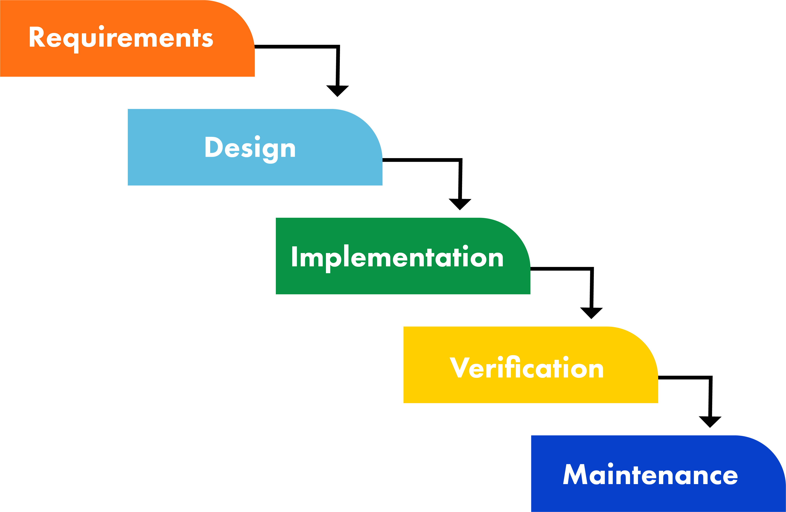

 

The original Waterfall method's steps included Requirements Determination, Design, Implementation, Verification, and Maintenance. 

Other models change the Requirements phase into the Idea phase, or break the Requirements phase out into Planning and Analysis. Furthermore, some models further break the Design phase out into Logical and Physical Design sub-phases. However, the basic underlying principles remain the same.

Below, the major stages of the Waterfall method are elaborated:

- The Waterfall method makes the assumption that all requirements can be gathered up front during the Requirements phase. 
  - Communication with the user is front-loaded into this phase, as the Project Manager does his or her best to get a detailed understanding of the user's requirements. Once this stage is complete, the process runs "downhill" like a waterfall, where the water starts at the top and flows downward.
- The Design phase is best described by breaking it up into Logical Design and Physical Design sub-phases. 
  - During the Logical Design phase, the system's analysts makes use of the information collected in the Requirements phase to design the system independently of any hardware or software system. 
  - Once the higher-level Logical Design is complete, the systems analyst then begins transforming it into a Physical Design dependent on the specifications of specific hardware and software technologies.
- The Implementation phase is when all of the actual code is written. This phase belongs to the programmers in the Waterfall method, as they take the project requirements and specifications, and code the applications.
- The Verification phase was originally called for to ensure that the project is meeting customer expectations. 
  - Software testing takes place during the Verification phase.
  - The project is rolled out to the customer, and the Maintenance phase begins.
- During the Maintenance phase, the customer is using the developed application. 
  - As problems are found due to improper requirements determination or other mistakes in the design process, or due to changes in the users' requirements, changes are made to the system during this phase.