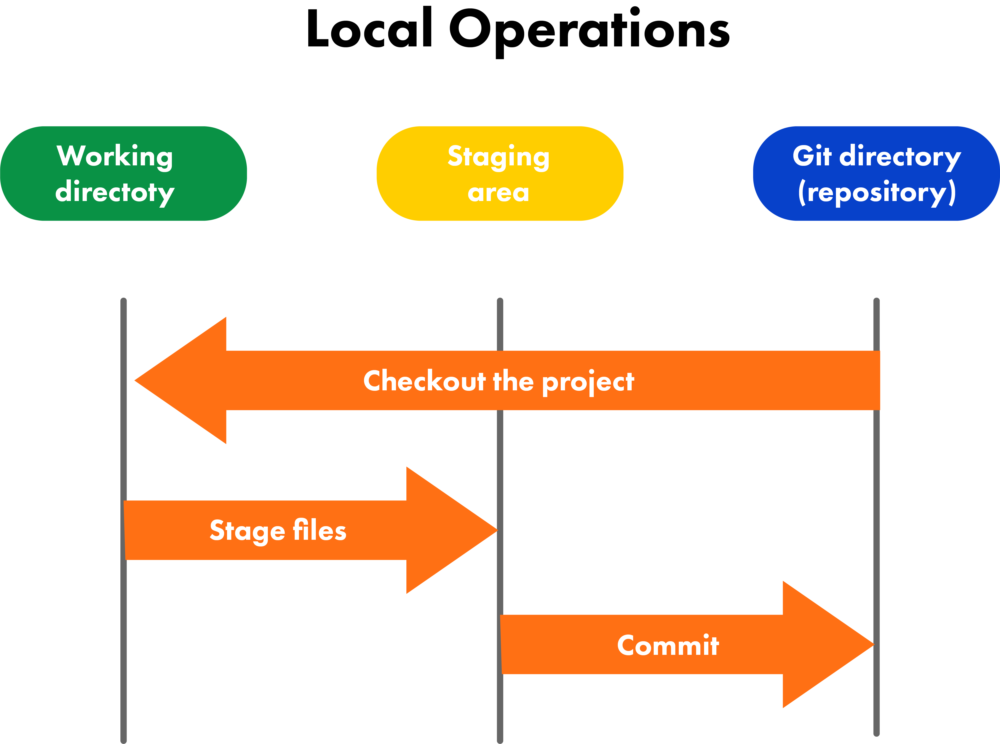
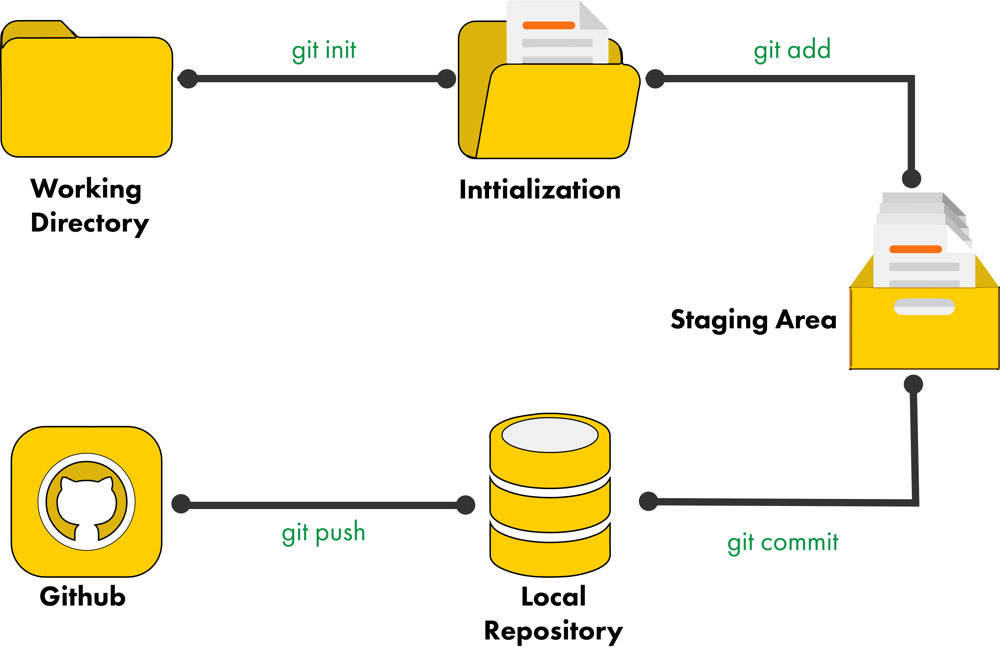

### What is version control?

Version control, also known as source control, is the practice of tracking and managing changes to software code. Version control systems (VCS) are software tools that help software teams manage changes to source code over time. As development environments have accelerated, version control systems help software teams work faster and smarter. 

Version control software keeps track of every modification to the code in a special kind of database. If a mistake is made, developers can turn back the clock and compare earlier versions of the code to help fix the mistake while minimizing disruption to all team members.

One of the most popular VCS's is Git.

### Nearly Every Operation Is Local

Because Git is a distributed version control system, most operations in Git need only local files and resources to operate — generally no information is needed from another computer on your network. Because you have the entire history of the project right there on your local disk, most operations seem almost instantaneous.

This means that there is very little you can’t do if you’re offline or off VPN. If you get on an airplane or a train and want to do a little work, you can commit happily (to your local copy, remember?) until you get to a network connection to upload. If you go home and can’t get your VPN client working properly, you can still work.

### The Three States
Git has three main states that your files can reside in: modified, staged, and committed:
- Modified means that you have changed the file but have not committed it to your database yet.
- Staged means that you have marked a modified file in its current version to go into your next commit snapshot.
- Committed means that the data is safely stored in your local database.

### Main sections of a Git project
This leads us to the three main sections of a Git project: the working tree, the staging area, and the Git directory.
- The working tree (or working directory, as in the diagram below) is a single checkout of one version of the project, downloaded to your local machine. The working tree is the set of all files and folders a developer can add, edit, rename and delete during application development.  These files are pulled out of the compressed database in the Git directory and placed on disk for you to use or modify.
- The staging area is a file, generally contained in your Git directory, that stores information about what will go into your next commit. Its technical name in Git parlance is the “index”, but the phrase “staging area” works just as well. (See diagram below)
- The Git directory is where Git stores the metadata and object database for your project. This is the most important part of Git, and it is what is copied when you clone a repository from another computer. (See diagram below)

### Git Workflow
The basic Git workflow goes something like this:
- You modify files in your working directory.
- You selectively stage just those changes you want to be part of your next commit, which adds only those changes to the staging area. (See "git add" in the diagram below)
- You commit the changes, which takes the files as they are in the staging area and stores that snapshot permanently to your Git directory. (See "git commit" and "git push" in the diagram below)

If a particular version of a file is in the Git directory, it’s considered committed. If it has been modified and was added to the staging area, it is staged. And if it was changed since it was checked out but has not been staged, it is modified. 

### What is Git Bash?

Git Bash is an application for Microsoft Windows environments which provides an emulation layer for a Git command line experience. Bash is an acronym for Bourne Again Shell. A shell is a terminal application used to interface with an operating system through written commands. Bash is a popular default shell on Linux and macOS. Git Bash is a package that installs Bash, some common bash utilities, and Git on a Windows operating system.