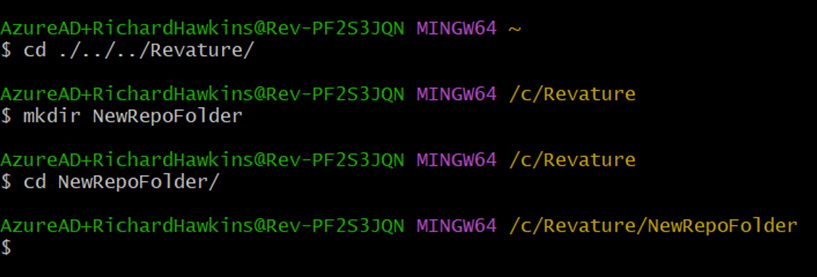
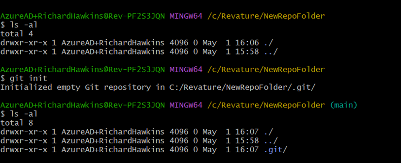
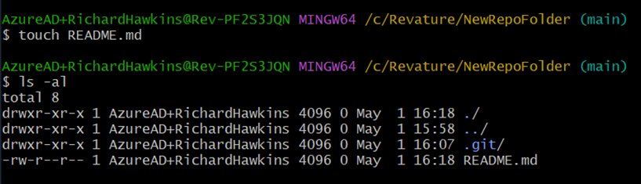
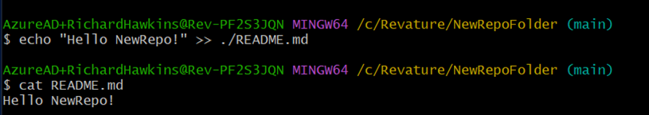
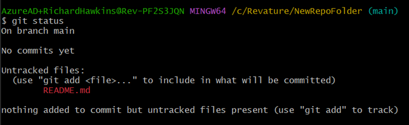
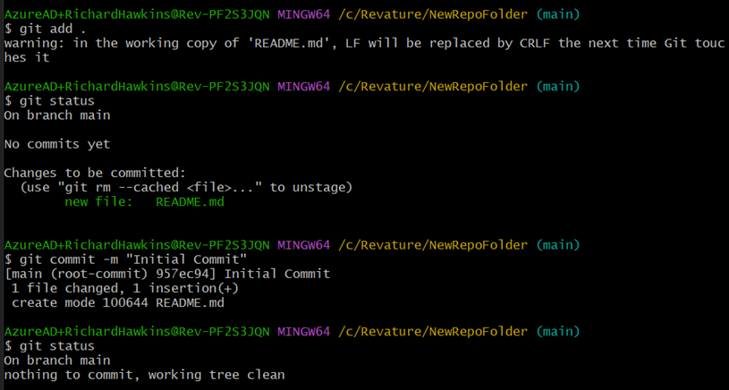
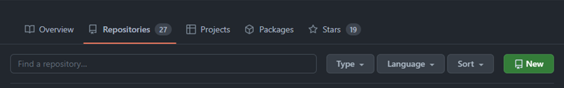
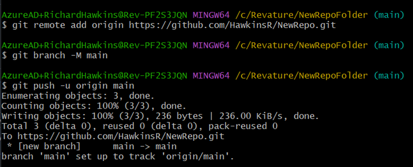

# Cumulative for the  Guided Coding Example Creating a repo

Description

# GFT-GCE-REPO
# Git Fundamentals - Creating A Repo

### Contributors:
Richard Hawkins
{ Reviewers }

## Prerequisites
- Bash terminal with git installed - for most associates, installing a gitBash terminal emulator is the fastest and easiest way to accomplish this. For mac users, a zsh terminal will accept bash commands.
- [GitHub account](https://www.github.com)

# How to Complete
## 1. Open a terminal...
and navigate to the directory location that you would like to create a new repository(repo) in. Create new folders as necessary.  

## 2. Use `git init`...
to create a new empty git repo. It is usually good to demonstrate the creation of the .git folder by running `ls -al` commands before and after to hilight the new .git folder.  

## 3. Run the command...
`touch README.md` to create a new file in the newly created repo.  

## 4. Run the command...
`echo "Hello NewRepo" >> ./README.md` to append a line of text to the new README file.  

## 5. Run the command...
`git status` to show what changes have been made to the repo.  

## 6. Use `git add .`...
and `git commit` commands to add changes to staging, and commit those chages to the repository history.  
*NOTE: use `git status` commands to monitor the progress of the changes through the process.*  
*NOTE: use the `-m` flag with `git commit` to include a commit message in the command.*  

## 7. Open a browser...
and navigate to [GitHub](https://www.github.com). From the organization of your choice, use the green "New" button shown below to create a new repo. We will be connecting to this new repo in the next step.   

   
On the new repository creation page, give it the name "NewRepo", set it to public visibility, uncheck the "Add a README file" option, and set .gitignore to "None".
Use the green "Create Repository" button at the bottom of the page to finalize the reposity creation.

## 8. The page...
you are redirected to will include a URL or SSH login. Select HTTPS, and copy the generated address to your computer clipboard.  

## 9. Switch back...
to the terminal environment, and run the following commands:  
*NOTE: This may require logging in to github if this is the first time connecting to a remote repository from the terminal environment.*  
`git remote add origin {HTTPS address from clipboard}`  *On the local machine, create a remote entry called "origin" at the address {HTTPS address}.*  
`git branch -M main` - *On the local copy, create a new branch called "main".*  
`git push -u origin main` - *From the local copy, push to the remote. Set the upstream (remote) to the entry/address called "origin" on the remote branch "main".*  

## 10. Switch back...
to the browser, and reload the repository. It should refresh, and display the content of the remote repository (which should be an identical copy of the current content of the local repository) and contain the README.md file with the content "Hello NewRepo!".

# Alternate:
The steps outlined above demonstrate the process of creating a local repository, and then connecting it to a remote repository. These commands can be modified and a similar process can be used to connect to an existing repository or transfer work from one repository to another. Another sometimes quicker way to create a repository and link a remote to a local repo is to begin with the remote instance instead.

## 1. Follow steps 7 and 8 from the previous section to create a new remote repository, and copy the HTTPS address.
## 2. From the terminal, use the command `git clone {HTTPS address}` to copy and connect the remote repository to the local machine.
## 3. Create a file and add, commit, and push it to the remote repository.
## 4. Verify the change by viewing the remote repository on GitHub.

