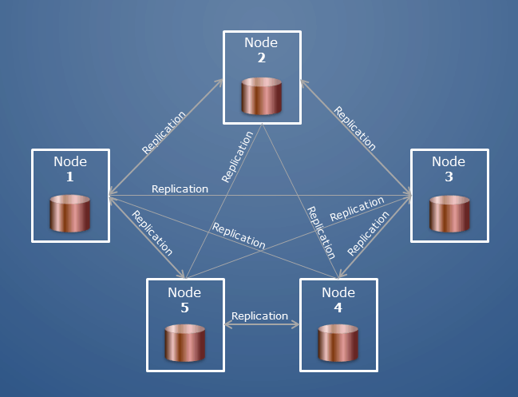

 

Databases provide the backbone of data persistence in enterprise applications. Large business applications are designed around the idea of scalability which emphasizes stateless execution. This means that a single application in the system won't store its own data locally, but use some other type of data persistence. RDBMS is a solution for this problem.

## Choosing persistence

System architects and project teams work to identify what type of persistence an application will need and incorporate it into the design of the system. RDBMS is just one solution, and there is a host of vendors to choose from. So how does one choose an RDBMS persistence provider. The following list is just a few features to consider.

- Distribution type
- Scalability
- License types
- Security features
- Support

### Distribution type

Installing the database is half the battle and of course there are a number of different ways to distribute the database software.

| Distro Type | Description                                                                        |
| ----------- | ---------------------------------------------------------------------------------- |
| Standalone  | Individually downloaded and installed software built for specific OS architectures |
| Managed     | Cloud-based installations like AWS RDS and GCP CloudSQL                            |
| Containers  | Container images like Docker                                                       |

Each distribution type has its pros and cons, which is out of the scope of this document, but each should be considered before choosing which distribution type works best for the solution.

## Scalability

Much like the applications that use databases for persistence, the databases themselves should be scalable. The problem is, databases can't be stateless. The scalability of a database is centered around clustering. Clustering is a scheme where multiple nodes are orchestrated to behave as a single unit. In RDBMS clustering however, there is a slight difference. An RDBMS cluster is constructed with a single master and multiple other replicas. This means all reads and writes happen primarily on the master with data being propagated to the replicas over time.

Most vendors implement some kind of clustering capabilities into their databases, so the biggest decision on clustering is, how much work do you want to do. The distribution type will play a big part in this with `Standalone` distributions requiring the most effort, `Managed` distributions requiring the least effort, and `Container` distributions somewhere in between.

## License type

Each vendor will have different license types. MySQL is free and so is PostgresSQL, but not all RDBMS systems are free. The project budget will dictate this decision. Feature sets are also often tied to license type so this will also help dictate this decision.

## Security features

Security is paramount to data. One should consider security trade-offs when deciding to use any software tool. These features could also be tied to license type.

## Support

A good support structure is essential for software especially for software not built by your team or company. It is good to have some way to get help when issues may arise. Support can come from different sources.

- Documentation
- Community forums
- Email/Chat
- Call center
- Technician/Specialist

Many times the level of available support is based on license type.
