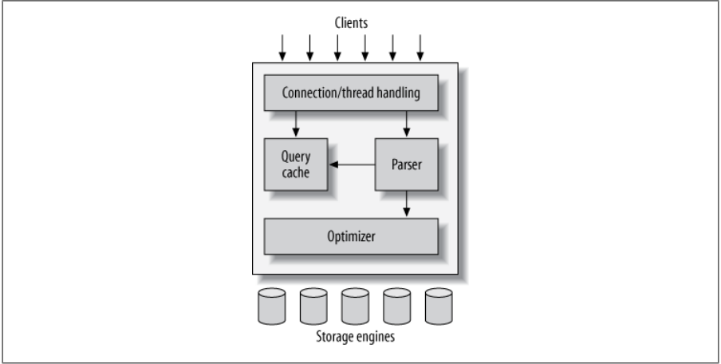

<br>

The implementation of an RDBMS is strictly dependent on the RDBMS vendor. Typically the implementation of the RDBMS is based on the SQL standard and there are many different RDBMS vendors. Below is a non-exhaustive list of popular RDBMS vendors.

- Oracle
- MySQL
- PostgreSQL
- SQL Server
- MariaDB
- SQLite

Since the implementation of the system is dependent on the RDBMS vendor, the architecture can vary drastically. Below is a simple breakdown of the MySQL architecture.



The architecture can be broken down into 6 parts.

| Component          | Purpose                                                                                                                                             |
| ------------------ | --------------------------------------------------------------------------------------------------------------------------------------------------- |
| Client             | Provides users the ability to connect to database servers and execute commands.                                                                     |
| Connection Handler | Receives incoming client connections and create new thread execution contexts for isolating client connections from each other.                     |
| Parser             | Validate and convert SQL commands to system commands.                                                                                               |
| Query Cache        | Store query results for later retrieval when the same commands are executed.                                                                         |
| Optimizer          | Apply available engine optimizations to execute queries in the most optimal way to reduce query execution time and ensure properly execution order. |
| Storage Engine     | Stores data on hard drives for persistent access.                                                                                                   |

It is important to note that this diagram is not comprehensive and is not an accurate representation of all implementations of SQL based RDBMS, but does illustrate some important parts of the system. To understand the particular architecture of the DB vendor you are using, additional research will be needed.

## Data structure

The discussion of vendor choice and vendor implementation aside an RDBMS is a DBMS based on relationships, all RDBMS implementations are based on some simple relation concepts.

An RDBMS manages data by storing them in tables. A single relational database can contain many tables along with many other types of objects. RDBMS serves as the basis for Structured Query Language (SQL) which is used to perform the various management operations on the system.

### What is a table

One of the core components of an RDBMS is an object called a `table`. Data in the RDBMS is store in `tables`. A `table` consists of related data entries called `rows` or `records` and each `row` consist of numerous `columns` or `fields`. A `column` is defined by a number of `constraints`.

Let's look at an example table called 'Employees'.

```
+----+-----------+----------+------------+-----------+
| id | firstName | lastName | department | reportsTo |
+----+-----------+----------+------------+-----------+
|  1 | Jimmy     | Johnson  |          1 |      NULL |
|  2 | Aaron     | Anderson |          1 |         1 |
|  3 | Emily     | Emerson  |          1 |         1 |
+----+-----------+----------+------------+-----------+
```

### What is a Row

A `row` is an individual entry that exists in a table. The terms `row` and `record` can be used interchangably. In the 'Employees' table there are 3 rows. Below is a single row.

```
+----+-----------+----------+------------+-----------+
|  1 | Jimmy     | Johnson  |          1 |      NULL |
+----+-----------+----------+------------+-----------+
```

### What is a Column

A `column` is the smallest entity of a table. A single column makes up a single data point on a row. The 'Employees' table has 5 columns:

```
+----+-----------+----------+------------+-----------+
| id | firstName | lastName | department | reportsTo |
+----+-----------+----------+------------+-----------+
```

### What is a constraint

A `constraint` is some restriction on the type or value that can be assigned to a `column`. In the 'Employee' table, each of the 5 columns has set of constraints on them, for instance the 'firstName' column has a `constraint` of `not null` which means this `column` must always have a value and can never be null.

<hr/>

## Exercise (Optional)

Discuss: Why do you think the `department` and `reportsTo` columns have number values rather than some other meaningful values?

Discuss: What is the intended purpose of the `id` column?
