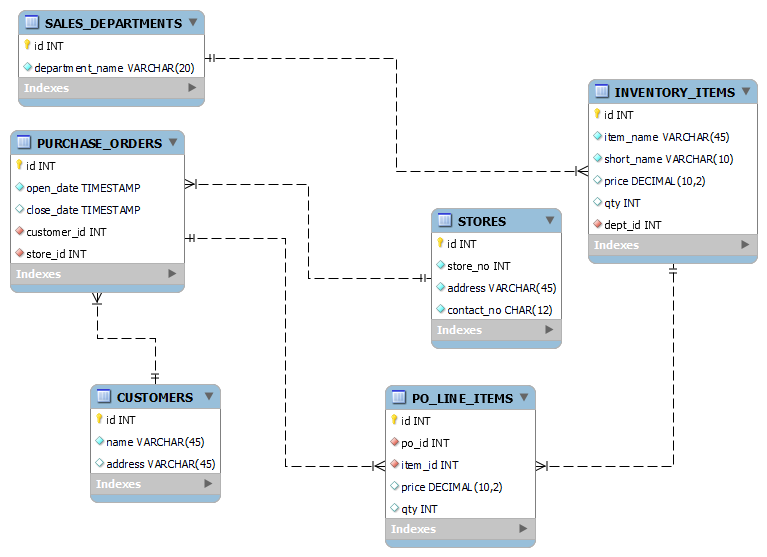

## Data Modeling

Data modeling is a conceptual representation of the data objects, data object relationships, and data object rules. It is used to help save costs, improve documentation, reduce time to market, and establish consistent data.

Data modeling is not strictly limited to the relational databases, but can include a variety of data models such as:

    - JSON Data Model
    - Key-Value Data Model
    - Graph Data Model
    - Wide-Column Data Model

These examples of data models are good to know of and feel free to research on them, but for the purpose of the SQL unit, we focus on the relational data model.

## Entity Relationship Diagram (ERD)

Entity Relationship Diagram is a graphical representation depicting the relationships among data objects within a database. These entities, such as people, objects or concepts relate to one another within the database. Also known as ER Models, these define a set of symbols such as rectangles, diamonds and connecting lines to depict the entities relationship and their attributes. Seen in the example below:

Each table is titled with a name representing the entity. At the top of each table there is a key symbol depicting our primary key, red diamonds for foreign keys and all others denoting the remaining entity attributes.