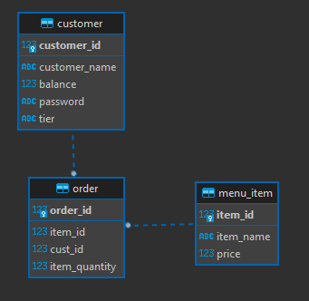

 

Data Modeling and ERDs can be generated through third party softwares such as Microsoft Visio, LucidChart and a variety of other web based diagram tools. For our purpose we can simply make ERDs with our database IDE (DBeaver). While in DBeaver to generate an ERD of your database simply follow these steps:

1. Select your database and expand in the Database Navigator Menu on left-hand side.
2. Expand your Databases inside of your database
3. Expand the name of your database
4. Expand the Schemas directory
5. Right-click on the schema you wish to generate an ERD, select View Diagram.
6. DBeaver, will open a new tab in the editor with an extremely basic version of an ERD for your tables. See below:

