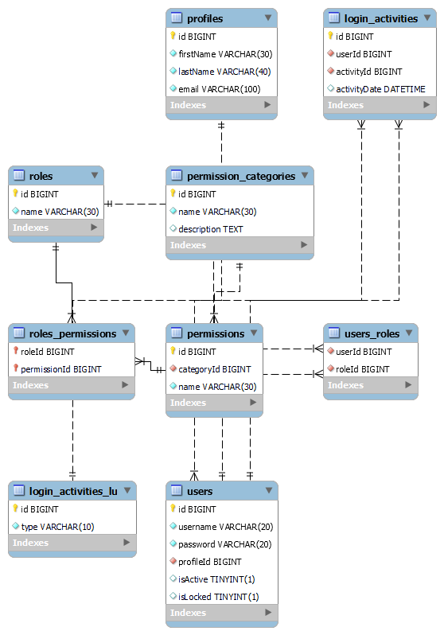

<br>

The DDL sublanguage is used to define the structure of the database that will model the data which is used to persist application state. The main commands behind DDL are `CREATE`, `DROP`, `ALTER`, `TRUNCATE`, `RENAME`, `COMMENT`. The combination of these commands are used to maintain the structure of the database designed to support application functionality.

Database administrators use the DDL sublanguage to define complex tables and the relationships between them, the constraints on the data in the table, search indexs, large table partitions, and so on. Let's envision a complex system for user-identity management. Some of the concepts here go beyond the atomic concept of DDL and creating or maintaining structure. Focus on just the DDL specific tasks.



The script required to create this ERD is a combination of the `CREATE` and `ALTER` commands.

```SQL
CREATE DATABASE IF NOT EXISTS IAM;

USE IAM;

CREATE TABLE IF NOT EXISTS permission_categories (
	id BIGINT PRIMARY KEY,
    name VARCHAR(30) NOT NULL UNIQUE,
    description text(255)
);

CREATE TABLE IF NOT EXISTS permissions (
	id BIGINT PRIMARY KEY,
    categoryId BIGINT NOT NULL,
    name VARCHAR(30) NOT NULL UNIQUE,
    index(categoryId, name)
);

CREATE TABLE IF NOT EXISTS roles (
	id BIGINT PRIMARY KEY,
    name VARCHAR(30) NOT NULL UNIQUE
);

CREATE TABLE IF NOT EXISTS roles_permissions(
	roleId BIGINT,
    permissionId BIGINT,
    PRIMARY KEY(roleId, permissionId)
);

CREATE TABLE  IF NOT EXISTS login_activities_lu (
	id BIGINT PRIMARY KEY,
    type VARCHAR(10) NOT NULL UNIQUE
);

CREATE TABLE IF NOT EXISTS profiles (
	id BIGINT PRIMARY KEY,
    firstName VARCHAR(30) NOT NULL,
    lastName VARCHAR(40) NOT NULL,
    email VARCHAR(100) NOT NULL UNIQUE
);

CREATE TABLE IF NOT EXISTS users (
	id BIGINT PRIMARY KEY,
    username VARCHAR(20) NOT NULL UNIQUE,
    password VARCHAR(20) NOT NULL,
    profileId BIGINT NOT NULL,
    isActive BOOLEAN DEFAULT true,
    isLocked BOOLEAN DEFAULT false
);

CREATE TABLE IF NOT EXISTS login_activities (
	id BIGINT PRIMARY KEY,
    userId BIGINT NOT NULL,
    activityId BIGINT NOT NULL,
    activityDate DATETIME DEFAULT NOW()
);

CREATE TABLE IF NOT EXISTS users_roles (
	userId BIGINT NOT NULL,
    roleId BIGINT NOT NULL
);

ALTER TABLE permissions ADD CONSTRAINT fk_permissions_category_id FOREIGN KEY(categoryId) REFERENCES permission_categories(id);
ALTER TABLE roles_permissions ADD CONSTRAINT fk_permissions_role_id FOREIGN KEY(roleId) REFERENCES roles(id);
ALTER TABLE roles_permissions ADD CONSTRAINT fk_roles_permission_id FOREIGN KEY(permissionId) REFERENCES permissions(id);
ALTER TABLE users ADD CONSTRAINT fk_users_profile_id FOREIGN KEY(profileId) REFERENCES profiles(id);
ALTER TABLE login_activities ADD CONSTRAINT fk_login_user_id FOREIGN KEY(userId) REFERENCES users(id);
ALTER TABLE login_activities ADD CONSTRAINT fk_login_activity_id FOREIGN KEY(activityId) REFERENCES login_activities_lu(id);
ALTER TABLE users_roles ADD CONSTRAINT fk_ur_user_id FOREIGN KEY(userId) REFERENCES users(id);
ALTER TABLE users_roles ADD CONSTRAINT fk_ur_role_id FOREIGN KEY(roleId) REFERENCES roles(id);
```

Once the schema is created using DDL, the responsibility for maintaining the schema falls upon the database administrator to continuously manage the structure in response to changing requirements. The need to add new tables, remove tables, add constraints or columns could present themselves on a daily basis as teams coordinate their needs for persistent data structure.
