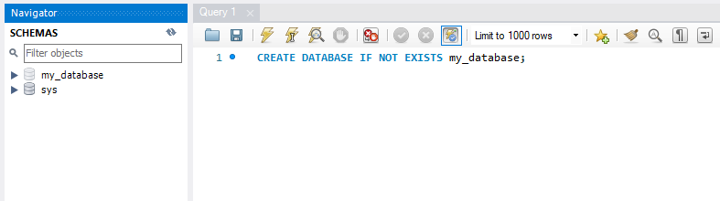
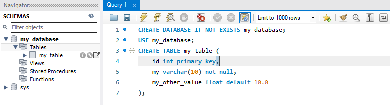
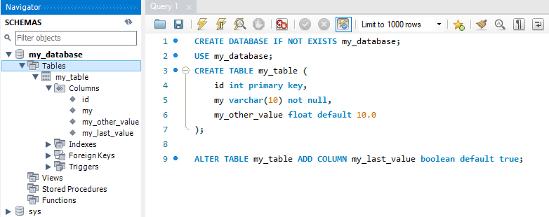

### Create

Let's start out by creating a new database. The syntax for creating a database is,

```sql
CREATE {DATABASE | SCHEMA} [IF NOT EXISTS] db_name;
```

Let's create a database named `my_database`

```SQL
CREATE DATABASE IF NOT EXISTS my_database;
```

The results:



**NOTE: it may be required to refresh your IDE view to see the results**

The same `CREATE` command can be used to create a table in the newly created database, with slight change to the syntax.

```SQL
CREATE [TEMPORARY] TABLE [IF NOT EXISTS] table_name (create_definition, ...) [table_options] [partition_options]
```

Focus on the create command and the `(create_definition)`. The create_definition section of the statement can be summed up as the definition of the columns in the table. Generally in this format.

```SQL
(
    col_name data_type constraints,
    ...
)
```

Let's now create a table call `my_table`

```sql
USE my_database;
CREATE TABLE my_table (
	id INT PRIMARY KEY,
    my VARCHAR(10) NOT NULL,
    my_other_value FLOAT DEFAULT 10.0
);
```

The results:



**NOTE: In MySQL it is necessary to select a database to which to apply statements. You should execute the `USE db_name` statement before the create statement**

Now that the database has some structure, let's use the `ALTER` command to change the structure of the table. The syntax.

```SQL
ALTER TABLE table_name [alter_option, [alter_option], ...] [partition_options]
```

**NOTE: The `ALTER` command has a lot of different options depending on what and how you want to change the table.**

Let's alter the table by adding a column using the syntax:

```SQL
ALTER TABLE table_name ADD COLUMN col_name col_definition
```

```SQL
ALTER TABLE my_table ADD COLUMN my_last_value boolean default true;
```

The results:



At this point the database has a working structure. Following is the syntax of the remaining commands which are trivial in comparison.

```SQL
DROP [TABLE] table_name
```

### Rename

```SQL
RENAME TABLE old_name TO new_name [, old2_name TO new2_name] ...
```

### Truncate

```SQL
TRUNCATE [TABLE] table_name
```

<hr/>

## Exercise (Optional)

- Create a database named `library`
- In the `library` database create a table name `books`
  - column: id INT PRIMARY KEY
  - column: title VARCHAR(100) NOT NULL
  - column: author VARCHAR(50) NOT NULL
- Alter the `books`
  - Add column: publication_date not null timestamp
  - Add constraint: title unique
