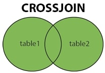

 

- `CROSS JOIN`, commonly known as a `CARTESIAN JOIN`, returns all possible row combinations from each table.
- If no condition is provided, the result set is obtained by multiplying each row of table1 with all rows in table2.

**Syntax**:  
SELECT *  
FROM Table1  
CROSS JOIN Table2;  