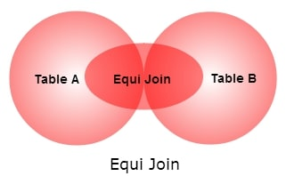

 

* `THETA JOIN` allows us to merge two tables based on an arbitrary condition, and is represented by the symbol theta (Θ or θ).
  * In other words, a `THETA JOIN` is a join in which some arbitrary comparison relationship is used. For example (”>”, “<”, “>=”, etc...)
  * For a `THETA JOIN` we make associations on columns that have the same datatype, but may represent different information for each table. For instance, we may join tables based on how old someone was when they got their driver’s license by using comparisons which include a “birth_year” column and a “years_as_driver” column.
  * The general case of JOIN operation is called a THETA JOIN.
* An `EQUI-JOIN` is a `THETA-JOIN` that uses the equality operator.
  * `EQUI-JOIN` is a common type of join, since it creates 1:1 relationships between matching data between tables.
* `EQUI JOIN` performs a join against equality or matching column(s) values of the associated tables.

**Syntax for Equi-Join**:  
SELECT *  
FROM Table1  
JOIN Table2 ON Table1.Column = Table2.Column;  

**Syntax for Theta-Join**:  
SELECT *  
FROM Table1, Table2  
WHERE Table1.Column > Table2.Column; 

