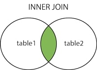

 

An `INNER JOIN` selects all rows from both tables as long as there is a match between the columns.  If there are data in the "Table1" table that do not have matches in "Table2", these orders will not be shown.

Syntax:   

SELECT column_name(s)  
FROM table1  
INNER JOIN table2  
ON table1.column_name = table2.column_name;

