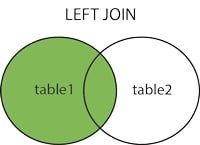
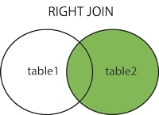

 

- `LEFT JOIN` returns all records from the left table, and the records that match the condition from the right table.

**Syntax**: 

SELECT column_name(s)  
FROM table1  
LEFT JOIN table2  
ON table1.column_name = table2.column_name;    

- `RIGHT JOIN` returns all records from the right table, and the records that match the condition from the left table.

**Syntax**: 

SELECT column_name(s)  
FROM table1  
RIGHT JOIN table2  
ON table1.column_name = table2.column_name;  

**NOTE**: `LEFT` and `RIGHT` tables do not actually exist in a database it simply means the table written first or second. 

* The table mentioned first in a `LEFT JOIN` (on the left side of the JOIN keyword) is considered the "left" table, and all its rows will be included in the result set, regardless of whether there are matching rows in the table mentioned second (on the right side of the JOIN keyword).
* In a `RIGHT JOIN`, the table mentioned second is the "right" table, and all its rows will be included in the result set, regardless of whether there are matching rows in the table mentioned first.  

