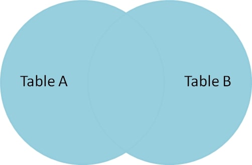

 

* An `OUTER JOIN`, yields non-matching records as well as matching records from both tables.
  * If rows in a connected table don't match, the `NULL` values will be shown.
* MySQL, does not support `OUTER JOIN` you must use a left `LEFT JOIN` or `RIGHT JOIN` to get the behaviors of a `OUTER JOIN`
* Some other dialects of SQL you can use a `FULL OUTER JOIN` or `FULL JOIN` to combine two tables data together.

