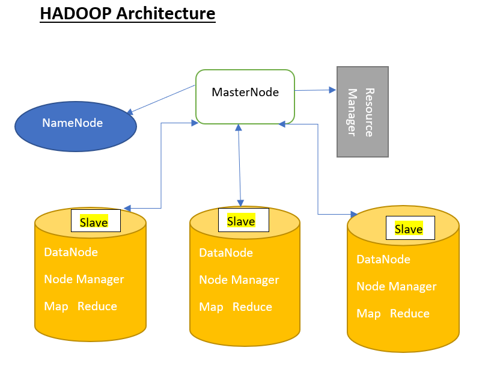

## Description

- Hadoop follows a master-slave architecture in which the master consists of namenode and resource manager and the slave consists of datanode, node manager and map-reduce phases. 

- The namenode and datanode are the part of HDFS(Hadoop Distributed File System), the resource manager and node manager are the part of YARN(Yet Another Resource Negotiator) and Map and Reduce Phase are the part of Map-Reduce Framework. 

### Hadoop Architecture Components  
  
  
    

- **MasterNode:** It is the main node of the system which keeps information of namenode, journal node and job trackers. Without it any processing cannot be done in Hadoop. 

- **NameNode:** It is responsible for managing and maintaining the file system namespace including files and directories present in Datanode. 

- **Datanode:** It is the place where actual data is stored in HDFS. Each Datanode can store multiple data blocks of default size 128mb. 

- **Resource Manager:** It consists of two things, one is Job Tracker which resides in master node and is responsible for accepting map-reduce jobs from clients and process that data with the help of namenode. The second one is Task Tracker which resides in the slave node and receives the task send by job tracker and performs processing on those task. 

- **Map Reduce Framework:** This framework works in two phases one in Map phase also called as Mapper and another one is Reduce phase also known as Reducer. The mapper takes the input from HDFS, process it and send the output of map phase to the reducer. The reducer's input is the output of map phase and it further applies some processing on the input and send the final outcome to the master node. 

---
