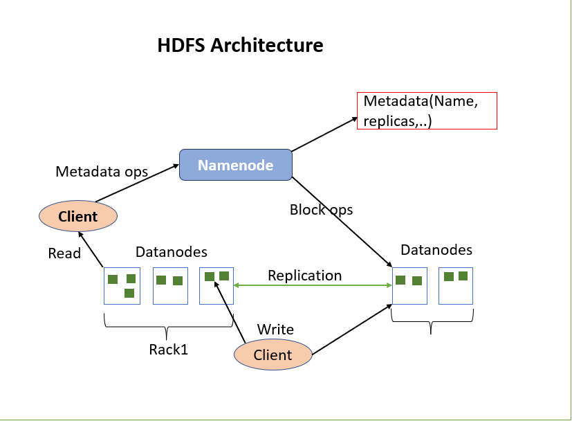

In this module, we learned:

- Hadoop is a distributed framework for storing and processing large datasets.
- HDFS is Hadoop’s storage layer.
- HDFS follows a master-worker architecture.
- NameNode manages metadata.
- DataNodes store actual data blocks.
- Secondary NameNode performs checkpointing.
- Data replication ensures fault tolerance.

HDFS enables scalable, reliable, and distributed storage for Big Data environments.

