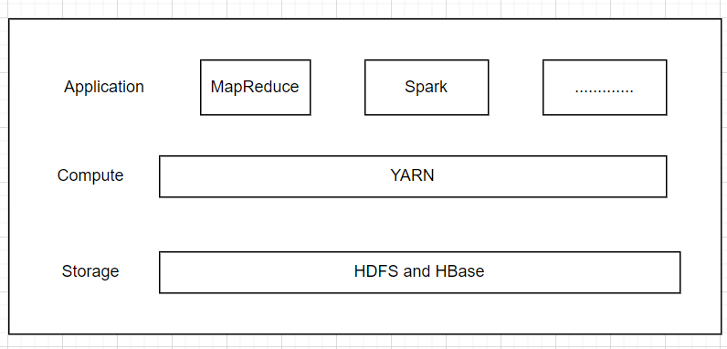
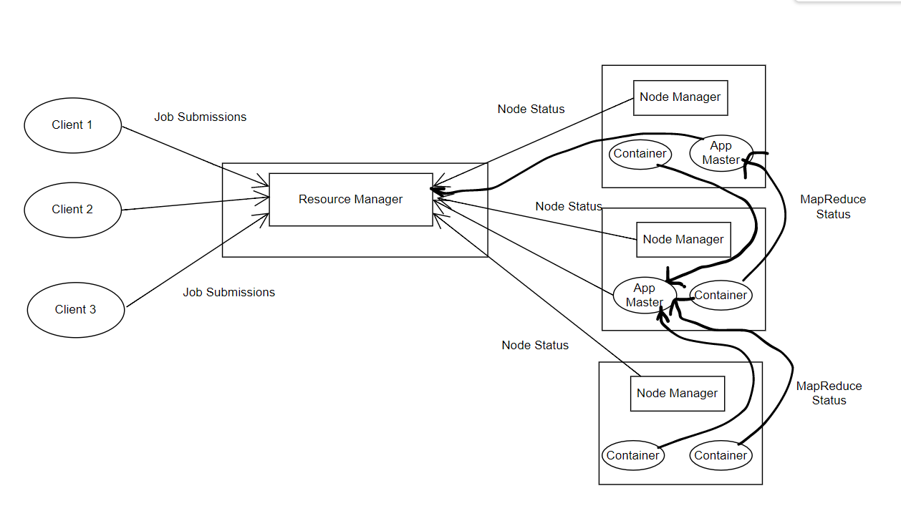

# Introduction to YARN

YARN (Yet Another Resource Negotiator) is Hadoop’s cluster resource management layer. It was introduced in Hadoop 2.0 to address scalability and flexibility limitations in the original Hadoop 1.x architecture.

In Hadoop 1.x:
- MapReduce handled both **data processing** and **resource management**.
- The JobTracker was responsible for everything.
- This created scalability bottlenecks and limited support to only MapReduce.

YARN solves this by separating concerns:
- **Resource management**
- **Application processing**

This architectural separation allows multiple distributed processing engines (not just MapReduce) to run on the same Hadoop cluster.

In simple terms:

YARN is the traffic controller of the Hadoop cluster.  
It decides who gets CPU, who gets memory, and where tasks should run.

---

## Why YARN Was Introduced

YARN was introduced to:

1. Remove the single JobTracker bottleneck.
2. Improve scalability for large clusters.
3. Allow multiple data processing frameworks.
4. Increase cluster utilization.
5. Enable multi-tenant environments.

Without YARN, Hadoop would remain limited to MapReduce workloads.

---

## Core Responsibilities of YARN

YARN is responsible for:

- Managing cluster-wide resources (CPU, memory).
- Scheduling applications.
- Allocating containers to applications.
- Monitoring node health.
- Restarting failed tasks.
- Supporting multiple processing frameworks.

It does NOT process data itself.  
It manages the environment where processing happens.

---

## Features of YARN

1. **Scalability**  
   Can manage clusters with thousands of nodes efficiently.

2. **Compatibility**  
   Supports MapReduce, Spark, Tez, Flink, and other distributed frameworks.

3. **Improved Cluster Utilization**  
   Dynamically allocates resources instead of reserving them statically.

4. **Multi-tenancy**  
   Multiple users and departments can share the same cluster.

5. **Resource Sharing**  
   Applications compete fairly using scheduling policies.

6. **Fault Tolerance**  
   Detects node failures and reassigns tasks automatically.

---

# Architecture of YARN

YARN consists of three major components:

- ResourceManager
- NodeManager
- ApplicationMaster

---

## 1. ResourceManager

The ResourceManager (RM) is the master authority of the cluster.

It has two main parts:

### a) Scheduler
- Allocates resources to applications.
- Uses scheduling policies like FIFO, Capacity Scheduler, or Fair Scheduler.
- Makes decisions based on resource availability.

### b) ApplicationManager
- Accepts job submissions.
- Launches the ApplicationMaster.
- Restarts ApplicationMaster if it fails.

There is typically only one ResourceManager per cluster.

---

## 2. NodeManager

The NodeManager (NM) runs on every node in the cluster.

Responsibilities:
- Monitors resource usage (CPU, memory, disk, network).
- Manages containers.
- Reports health status to the ResourceManager.
- Kills containers that exceed resource limits.

Each machine in the cluster runs exactly one NodeManager.

---

## 3. ApplicationMaster

Every application submitted to YARN gets its own ApplicationMaster.

Responsibilities:
- Negotiates resources from ResourceManager.
- Requests containers.
- Launches tasks on NodeManagers.
- Tracks task progress.
- Handles failures.
- Reports completion status.

If the ApplicationMaster fails, the ResourceManager can restart it.

---

# Understanding Containers in YARN

A container is a logical bundle of resources:

- Memory
- CPU
- Network

When an application needs resources:
1. ApplicationMaster requests containers.
2. ResourceManager allocates containers.
3. NodeManager launches tasks inside containers.

Containers isolate applications and ensure fair resource usage.

---

# Lifecycle of a YARN Application

1. Client submits application to ResourceManager.
2. ResourceManager launches an ApplicationMaster container.
3. ApplicationMaster registers with ResourceManager.
4. ApplicationMaster requests required containers.
5. ResourceManager allocates containers.
6. NodeManagers launch tasks inside containers.
7. ApplicationMaster monitors execution.
8. Application completes and resources are released.

---

# Advantages of YARN Over Hadoop 1.x

| Hadoop 1.x | Hadoop 2.x (YARN) |
|------------|-------------------|
| Single JobTracker | Separate ResourceManager & ApplicationMaster |
| Only MapReduce | Multiple frameworks supported |
| Scalability limitations | Highly scalable |
| Limited resource sharing | Efficient dynamic allocation |

---