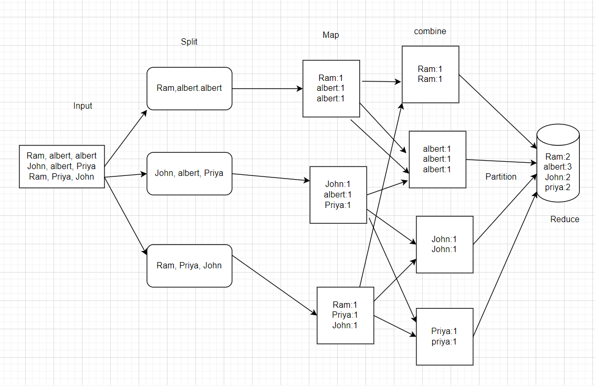

# Introduction 

MapReduce is a programming model for data processing. It is simple, yet not
too simple to express useful programs. MapReduce programs are inherently parallel, thus
putting very large-scale data analysis into the hands of anyone with enough machines
at their disposal. MapReduce comes into its own for large datasets.
Each phase has key-value pairs as input and output, the types of which
may be chosen by the programmer. 
It works by breaking the processing:

1. Mapper
2. Reducer 

It works by breaking the process into three phases: either the map phase ,shuffling and the
reduce phase. 

1. Mapping Phase 
2. Shuffling Phase
3. Reducer Phase 

1. Mapper 

It will process each input record and it generates a new <key, value> pairs. It can be completely different from the input pair. In mapper task, the output collects from key,value pairs. Before using the output for each mapper task, partitioning of output takes place on the basis of the key and then sorting is done.

It only understands <key, value> pairs of data, so before passing data to the mapper, data should be first converted into <key, value> pairs.

### Key-Value Pair generated 

- InputSplit – Basically it is the logical representation of data. Inputsplits describes a unit of work that contains a single map task in a MapReduce program. 
- RecordReader – It is used to communicate with the InputSplit and after that it converts the data into key-value pairs which is suitable for reading the Mapper.It uses TextInputFormat for converting data into the key-value pair. 

2. Reducer

It is used to process the output of the mapper. After processing the data,it will collect a new set of output. After that, HDFS stores this output data.
It uses a set of intermediate key-value pair which is produced by the mapper as the input and runs a Reducer function on each of them.

Phases of MapReduce Reducer :

- Shuffle Phase
- Sort Phase
- Reduce Phase

Example: Mapper Intermediate Reducer

