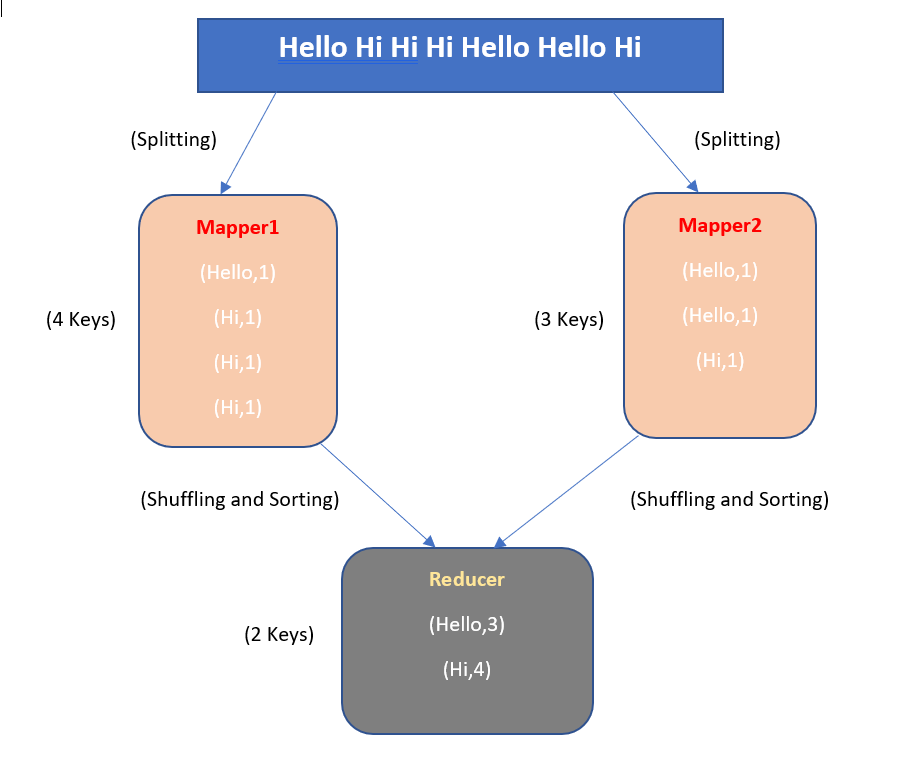
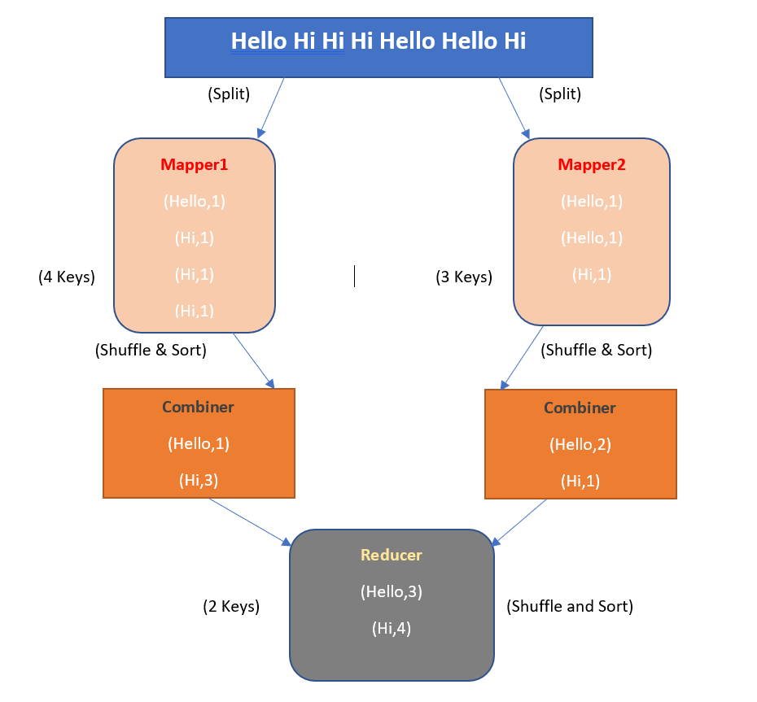

## Description

- Combiner in hadoop acts like a mini-reducer in map side. It takes the intermediate data from the mapper and applies shuffling and sorting on that data just like a reducer. 

- It not only reduces the overall time taken for sending data between mapper and reducer but also decreases the data that is required to process by the reducer.

- The use of combiner in-between mapper and reducer is optional and the unnecessary use of combiner may cause inexpensive disk IO. So, before using it, we have to make sure that we have enough resources in our system to handle all the combiner operations. 

- During the map job, the combiner can execute zero, one or more number of times and are independent of map reduce. Also the number of combiner can be anything depending on the size of data. 

## MapReduce job without Combiner 

- Let's say we have a text string as "hello hi hi hi hello hello hi" and we are using two mappers to process that string. So, when we send this string as input to mappers, the string data gets split into single word as key with their count value as 1. Then the mapper send this output result to the reducer which combines the same keys together and updates it frequency value. This example is shown in picture representation as below: 

 

## MapReduce Job With Combiner 

- Let's say this time we have used combiner that will do the work of shuffling and sorting of output data from each mapper. It will combine the same keys just like reducer but for one mapper data only and then it sends the generated combined data from each mapper to reducer, which futhers do the shuffling and sorting operation. The picture representation of map reduce job with combiner is shown below:

 

---
