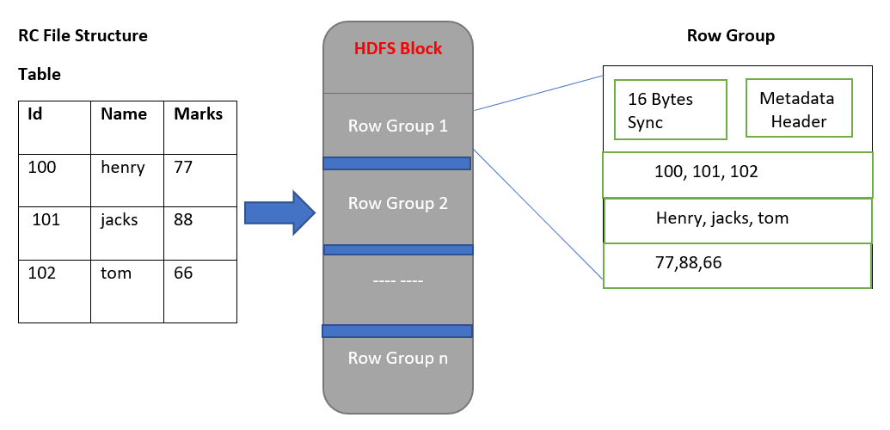
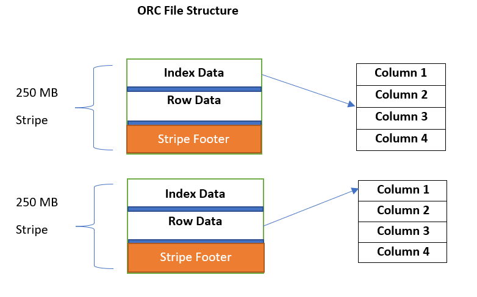
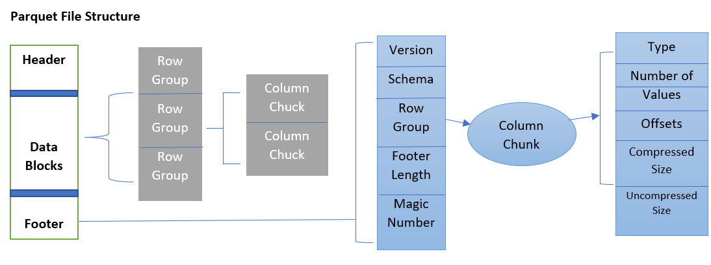

# Cumulative for the Input Formats topic
<details><summary>Learning Objectives</summary>

- Learn the different Hadoop data formats and how they differ.

</details>
<details><summary>Description</summary>

- Hadoop supports **seven** types of data formats: 
  - Text files/ CSV files
  - JSON files
  - Avro files
  - RC files
  - ORC files
  - Parquet files
  - Sequence files

**Text/CSV File Format:**

- Text files or CSV files are the most common files used by big data developers for storing text based inputs and comma-separated inputs. But these files do not support block compression and thus the read operations in CSV files are slower than those in other file formats. These files are recommended for data storage when we have smaller data sets. From **Excel**, it is easy to export to CSV… all the data is stored without any formulas or macros. that were applied to excel data.  

- For Example: 
```csv
Id,Name,Marks,Subjects 
100,henry,77.7,history
101,mark,66.6,physics
102,jacks,88.8,science
```

**JSON File Format:**

- JSON file stores the data in key–value pairs and are human readable like text files. Here each key is a column name which stores the value and each key value is separated by a colon (`:`). JSON files are good alternative for XML and are used for transferring data over the network. 

- For Example: 

```json
[
  { "Id": 100, "Name": "Henry", "Marks": 77.7, "Subjects": "History" },
  { "Id": 101, "Name": "Mark", "Marks": 66.6, "Subjects": "Physics" }
]
```


**Avro File Format:**

- Avro stores schemas in **JSON** and data in a compact **binary** format. It is widely used for large data sets in **Hadoop**. 

- For Example: 
```json
[
  { "Id": 100, "Name": "Henry", "Marks": 77.7, "Subjects": "History" },
  { "Id": 101, "Name": "Mark", "Marks": 66.6, "Subjects": "Physics" }
]
```

**Sequence File Format:**

- Sequence files are the flat files that store data in binary key–value pairs. MapReduce uses this file to store input/output data. Internally all the mappers store their intermediate data output using sequence file. 

**RC File Format:** 

- It was the the first columnar file format supported in **Hadoop**. It has high compression rate and used for fast querying on multiple rows at a time. RC files store the columns of a table into records in columnar fashion. You can’t load data directly into RC files; load into a table first, then write out to RC format. 



**ORC File Format:** 

- This file format is an optimized version of RC files where it reduces the original RC file size up to 75 percent. This results in faster than text, Sequence, or RC files. Like RC files, we cannot load data directly into ORC files. 



**Parquet File Format:**

- It is a column-oriented file just like ORC files but it stores the metadata and actual data together in the same file like Avro files. It stores the data in advanced binary format which helps in effective querying and retrieval of records. This file format is used widely in analytics. 


</details>
<details><summary>Real World Application</summary>

- In a real world scenario, developers are using a combination of file format according to their work need. If the need is to get the data in human readable format then text or CSV files are a good choice. If the need is to transfer the data over the network from source to destination with high speed then the Avro files are good to go. If the need is to analyze the data using hive or spark, then parquet files or RC files are good choices as their read performance is higher than other file formats. 


</details>
<details><summary>Summary</summary> 

- Hadoop mainly supports seven types of file formats for storing data. Each file format has its own usage in **Hadoop** and one file format can be converted to another file format with or without using any tool. 
- Text/CSV files used to store the text based data and are human readable. 
- JSON and Avro store data as key–value structures; Avro is a row-oriented binary format.
- RC/ORC and Parquet files are column-oriented formats that store data by column; they are compressed binary formats with high read performance. These files are highly compressed binary files and has high reading and retrieving data performance. 

</details>
<details><summary>Practice Questions</summary>

[Practice Questions](./Quiz.gift)</details>
