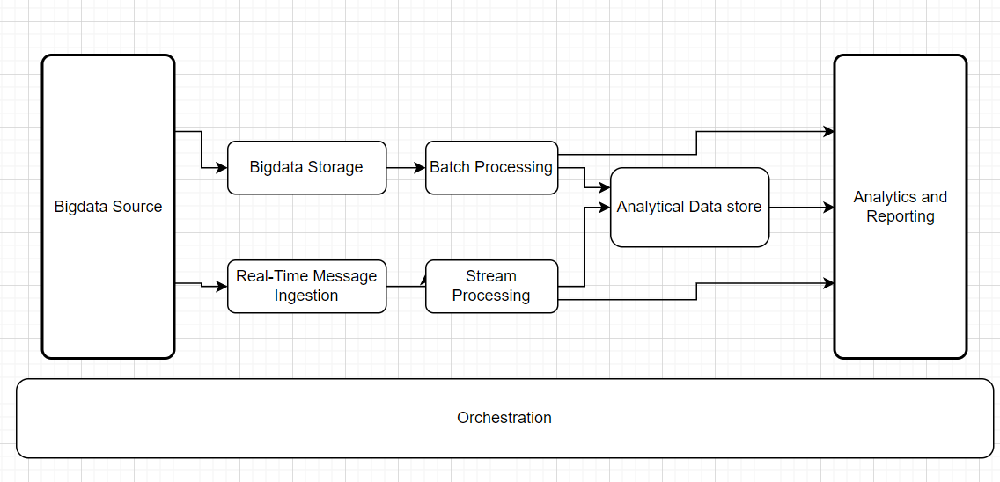

## Introduction to Big Data

Big Data refers to massive and complex datasets (structured, semi-structured, or unstructured) generated from multiple sources such as applications, sensors, devices, social media, and enterprise systems.

Traditional database systems cannot efficiently process this scale of data, which led to the development of distributed architectures.

---

## Big Data Architecture

A Big Data architecture is designed to handle:

- Data ingestion
- Data storage
- Data processing
- Data analysis
- Reporting and visualization

It supports data that is too large or complex for traditional systems.

---

### Workloads in Big Data Architecture

Big Data systems typically support one or more of the following workloads:

- Batch processing of large datasets at rest
- Real-time processing of streaming data
- Interactive data exploration
- Predictive analytics and machine learning

---

## Core Components of Big Data Architecture

A typical Big Data architecture includes:

- Data Sources  
- Data Ingestion Layer  
- Storage Layer  
- Processing Layer  
- Analytical Data Store  
- Analysis and Reporting  
- Orchestration and Monitoring  

### 1. Data Sources
Data originates from:
- Web applications
- IoT devices
- Transaction systems
- Logs and sensors

### 2. Data Ingestion
Responsible for collecting and importing data into the system.
Can be:
- Batch ingestion
- Real-time ingestion

### 3. Storage Layer
Uses distributed storage systems to handle large datasets efficiently.

### 4. Processing Layer
Processes data using distributed computing techniques such as:
- Batch processing
- Stream processing

### 5. Analytical Data Store
Stores processed and structured data for querying and reporting.

### 6. Analysis and Reporting
Generates insights using dashboards, reports, and analytics tools.

### 7. Orchestration
Manages workflows, scheduling, and system coordination.

---

## Benefits of Using Big Data

### Business and Market Benefits

- Provides deeper market understanding.
- Improves customer database quality.
- Enhances marketing strategies through behavioral insights.
- Enables data-driven decision-making.

### Operational Benefits

1. Customer acquisition and retention  
2. Focused and targeted promotions  
3. Risk identification and fraud detection  
4. Innovation and product development  
5. Supply chain optimization  
6. Cost optimization  
7. Improved operational efficiency  

---

## Challenges of Big Data

Despite its advantages, Big Data implementation presents several challenges:

- Data silos and inconsistent data quality
- Lack of strategic coordination in Big Data/AI initiatives
- Shortage of skilled professionals
- Solving incorrect business problems due to poor requirements
- Outdated data leading to inaccurate insights
- Difficulty in operationalizing analytics results

Organizations must balance infrastructure investment, governance, and skilled talent to overcome these challenges.