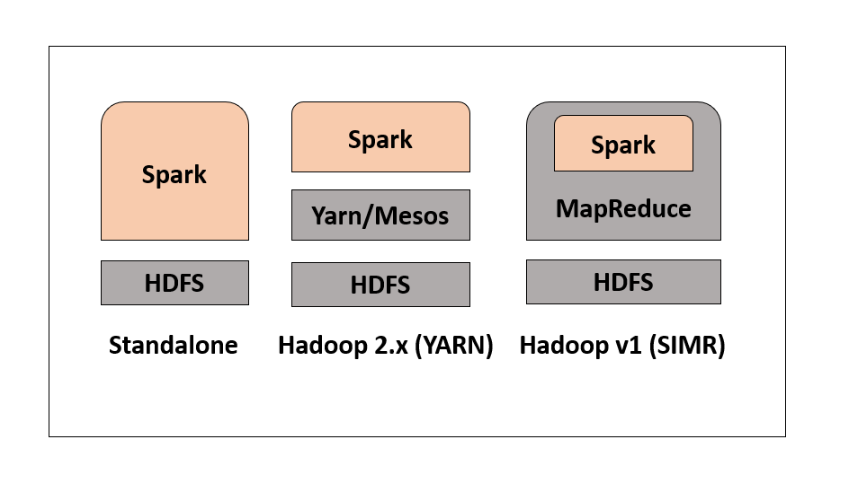

### History of Apache Spark

Apache Spark was initiated in 2009 by Matei Zaharia at UC Berkeley's
AMPLab to overcome performance limitations of Hadoop MapReduce. It was
open-sourced in 2010 and donated to the Apache Software Foundation in 2013. In 2014, Spark became a top-level Apache project.

Today, Spark is one of the most widely adopted distributed processing
engines in data engineering and data science ecosystems.

------------------------------------------------------------------------

### What is Apache Spark?

Apache Spark is a distributed, in-memory data processing engine designed
for large-scale data analytics. Unlike Hadoop MapReduce, which writes
intermediate results to disk, Spark keeps data in memory whenever
possible, significantly improving performance.

Spark supports:

-   Batch data processing
-   Interactive SQL queries
-   Real-time data processing (Structured Streaming)
-   Machine learning
-   Graph processing

Spark is not a replacement for Hadoop but can run on Hadoop clusters or
independently.

------------------------------------------------------------------------

### Why Spark?

Hadoop MapReduce processes data in strict Map → Shuffle → Reduce stages
and frequently writes intermediate results to disk. This increases
latency.

Spark improves performance through:

-   In-memory computation
-   Directed Acyclic Graph (DAG) execution engine
-   Reduced disk I/O
-   Lazy evaluation of transformations

Performance benefits:

-   Up to 100x faster in memory
-   Up to 10x faster on disk compared to MapReduce

Spark also supports multiple programming languages including Python
(PySpark), Scala, Java, and SQL.

------------------------------------------------------------------------

### Key Features of Apache Spark

-   In-memory distributed processing
-   Fault tolerance via RDD lineage
-   Lazy evaluation
-   DAG-based execution engine
-   Scalable cluster architecture
-   Multi-language API support
-   Unified analytics platform
-   Real-time and batch processing capabilities

------------------------------------------------------------------------

### Spark Architecture

Spark architecture includes:

1.  Driver Program
    -   Entry point of the Spark application
    -   Creates SparkSession
    -   Converts user code into tasks
2.  Cluster Manager
    -   Allocates resources
    -   Can be Standalone, YARN, or Kubernetes
3.  Worker Nodes
    -   Execute assigned tasks
4.  Executors
    -   Run tasks on worker nodes
    -   Store intermediate data

Spark uses a DAG scheduler instead of traditional MapReduce stages,
enabling optimized execution plans.

------------------------------------------------------------------------

### Spark Deployment Modes

1.  Standalone Mode
    -   Spark's built-in cluster manager
    -   Suitable for small to medium clusters
2.  Hadoop YARN
    -   Spark runs within Hadoop ecosystem
    -   Shares cluster resources
3.  Kubernetes
    -   Containerized Spark deployment
    -   Common in cloud-native environments

Note: Spark in MapReduce (SIMR) is outdated and rarely used in modern
architectures.

------------------------------------------------------------------------

### Spark Ecosystem Components

-   Spark Core → Fundamental distributed processing
-   Spark SQL → Structured data and SQL queries
-   Structured Streaming → Real-time stream processing
-   MLlib → Machine learning library
-   GraphX → Graph computation engine
