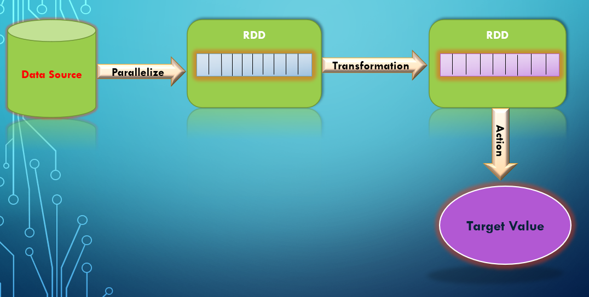

## What is an RDD?

RDD stands for **Resilient Distributed Dataset**.

An RDD is:

-   A distributed collection of data
-   Divided into logical partitions
-   Stored across multiple nodes in a cluster
-   Processed in parallel
-   Fault tolerant through lineage tracking
-   Immutable once created

RDD is the lowest-level data abstraction in Spark. Although Spark now
provides DataFrames and Datasets, those abstractions are internally
built on RDDs.

Understanding RDDs helps learners understand how Spark executes
distributed computations under the hood.

------------------------------------------------------------------------

## Why RDD Was Introduced

Before Spark, Hadoop MapReduce dominated big data processing. However:

-   MapReduce writes intermediate results to disk after every stage
-   Iterative algorithms become slow due to repeated disk I/O
-   Interactive analytics becomes inefficient

Spark introduced RDDs to enable:

-   In-memory computation
-   Efficient iterative processing
-   Reduced disk I/O
-   Faster performance for analytics and machine learning

------------------------------------------------------------------------

## Core Characteristics of RDD

### 1. Immutable

Once an RDD is created, it cannot be modified.

Instead of modifying data: - Transformations create a new RDD - Original
RDD remains unchanged

This design ensures safe parallel execution and prevents concurrency
issues.

Example:

``` python
rdd2 = rdd1.map(lambda x: x * 2)
```

------------------------------------------------------------------------

### 2. Resilient (Fault Tolerant)

RDDs track transformations in a lineage graph (Directed Acyclic Graph -
DAG).

If a node fails: - Spark identifies the lost partition - Uses lineage to
recompute only that partition - Avoids recomputing the entire dataset

This eliminates the need for expensive data replication.

------------------------------------------------------------------------

### 3. Lazy Evaluation

Transformations are not executed immediately.

Spark builds an execution plan and only executes it when an action is
triggered.

Benefits: - Optimized execution plan - Reduced redundant computation -
Efficient resource utilization

Example:

Transformation:

``` python
rdd2 = rdd1.map(lambda x: x + 1)
```

Action:

``` python
rdd2.collect()
```

Execution happens only when `collect()` is called.



------------------------------------------------------------------------

### 4. Distributed

RDDs are partitioned across worker nodes.

Each partition: - Is processed by one task - Runs independently -
Contributes to parallelism

Number of partitions directly affects performance.

------------------------------------------------------------------------

### 5. Persistence and Caching

RDDs can be stored in:

-   MEMORY_ONLY
-   MEMORY_AND_DISK
-   DISK_ONLY

Example:

``` python
rdd.cache()
```

Caching is useful in iterative workloads where the same RDD is reused
multiple times.