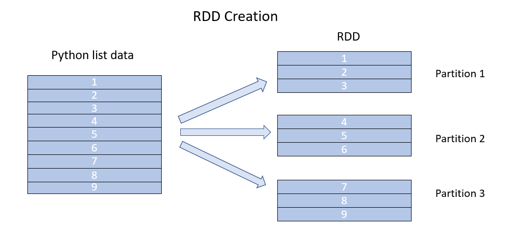

## Description

**RDD**
  
- The RDD (Resilient Distributed Dataset) is the basic form of data abstraction in Apache Spark and Spark Core. It is a fundamental Spark data structure. As fault-tolerant, immutable distributed groups of objects, RDDs cannot be altered after they have been created. Logical partitions are created for each dataset in RDD so that they can be calculated on several cluster nodes.

- Additionally, RDDs provide data abstraction for the distribution of the data and partitioning, which is intended to run computations concurrently across multiple nodes. When performing transformations on RDDs, we typically don't need to worry about parallelism because Spark already offers it by default.

**RDD Creation**

- RDDs are typically created in one of two ways: by parallelizing an existing collection or by referencing a dataset in an external storage system (HDFS, S3, and many more).

 

 

**sparkContext.parallelize()**

- The `sparkContext.parallelize() ` method is used to parallelize an existing collection in your driver program and this method is used to create RDD.

**sparkContext.textFile()**

- Using `textfile()` function or method we can read a text file into RDD.

**sparkContext.wholeTextFiles()**

- `sparkContext.wholeTextFiles()` function returns a PairRDD with the key being the file path and value being file content.

**sparkContext.emptyRDD()**

- Using `sparkContext.emptyRDD()` method on SparkContext we can create an RDD with no data and this method is used to create an empty RDD with no partition.

**Creating empty RDD with partition**

- An empty RDD may sometimes need to be written to files using partitioning; in this case, you should create an empty RDD with partition.

**RDD Parallelize and repartition**

- When we use parallelize(), textFile(), or wholeTextFiles() methods to launch RDD, the data is automatically partitioned based on resource availability.

**getNumPartitions** - Returns a number of the partitions our dataset was divided into. Any transformations that are applied to an RDD execute concurrently. For each partition of the cluster, Spark will execute a single task.

**Set parallelize manually** - The second parameter of these operations, such as `sparkContext.parallelize(dataSeq, 10) `, can be used to explicitly set the number of partitions if needed.

**Repalallize using repartition and coalesce** - Spark offers two methods for repartitioning RDDs: the `repartition()` method, also known as full shuffle, which shuffles data from all nodes, and the `coalesce()` method, which shuffles data from the minimum number of nodes. For example, if your data is divided into four partitions, coalesce(2) will only move data from two nodes.

**RDD Advantages**

- In-Memory Processing   
- Immutability   
- Fault Tolerance   
- Lazy Evolution   
- Partitioning   
- Parallelize   
